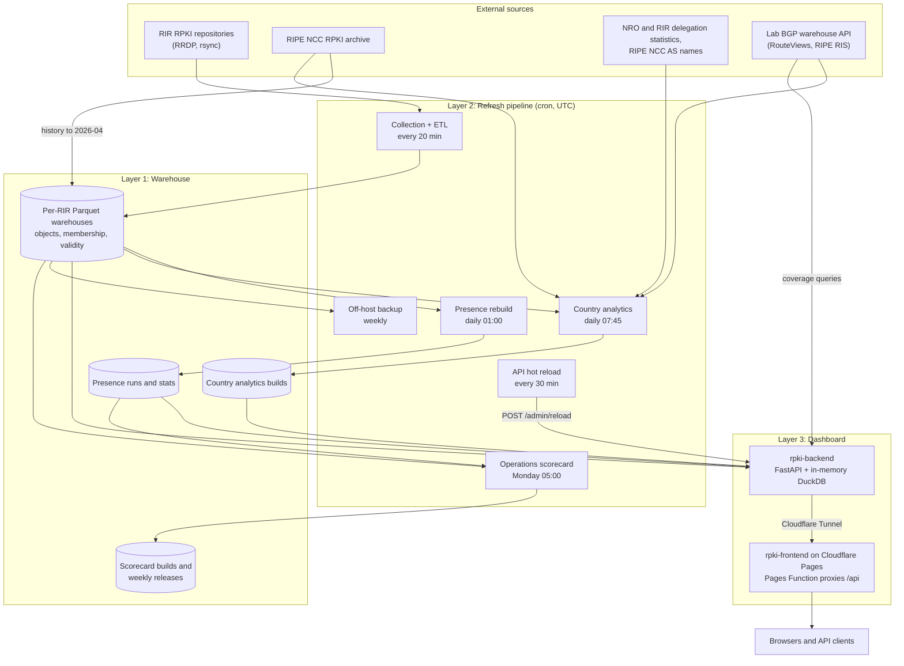

# RPKI Warehouse architecture

RPKI Warehouse keeps a history of the RPKI objects published under the five Regional Internet
Registries (RIRs) and serves it through a public API and a web dashboard at
<https://rpki.netsecurelab.org> (also <https://rpki-health.netsecurelab.org>). The NetSecure Lab
at Virginia Tech runs it. This repository, RPKI Health, holds its code. It serves:

- **RIRs and RPKI CA operators**: repository health over time, compared across RIRs.
- **Network operators**, starting with the ARIN region: what their ROAs authorize, and how much of
  their BGP announcements RPKI covers.
- **Researchers**: object-level history since 2012, an API, and (planned) dated data releases.

The system has three layers. The **warehouse** collects RPKI data with rpki-client and stores it
in per-RIR Parquet warehouses. The **refresh pipeline** is a set of scheduled jobs that add data
and rebuild derived tables. The **dashboard** is a read-only API over the warehouse, plus a web
UI. The layers meet through files on disk: the ETL and the jobs write Parquet files, and the API
only reads them. The one control link is a scheduled call that tells the API to re-read them.

## Repository layout

This repository receives release snapshots. Development happens in private repositories. For each
release, a script exports each component with `git archive` and records the source ref and commit
of each one in `VERSIONS.json`.

| Directory | Contents |
|---|---|
| [`parser/`](parser/) | Collection cycle (`rpki_cycle.sh`), ETL (`rpki_etl.py`) and object parsers, presence-run builder (`analysis/build_presence_runs.py`), research scripts (`analysis/`, `analysis2/`) |
| [`backend/`](backend/) | FastAPI app (`app/`), country analytics pipeline (`pipelines/country/`), weekly scorecard pipeline (`pipelines/scorecard/`), tests |
| [`frontend/`](frontend/) | React/Vite UI, and the Cloudflare Pages Function that proxies `/api` (`functions/api/[[path]].js`) |

Host configuration (crontab, systemd units, tunnel configuration, log rotation, backup and reload
scripts) is kept in a private operations repository. This document describes it in general terms.

## Overview

## Layer 1: Warehouse (`parser/`)

`rpki_cycle.sh` runs one collection cycle every 20 minutes:

1. `rpki-client` (9.x) runs with the trust anchor locators (TALs) and constraints files of the
   five RIRs. It updates a local cache over RRDP, with rsync as fallback, and logs a verdict per
   file.
2. `build_validity_map.py` maps each rejected object, by SHA-256, to a reason code such as
   `expired` or `no-manifest`. If this step fails, the cycle uses an empty map and goes on.
3. Each publication point in the cache is assigned to an RIR, from a table of host names or, for
   unknown hosts, by following the issuer (AIA) links of a sample object.
4. `rpki_etl.py single` loads each RIR's part of the cache into that RIR's warehouse.

A lock keeps cycles from overlapping: a cycle that starts while the previous one runs exits.

Storage model. Each RIR has its own warehouse directory, `warehouse-<rir>`.

- **Object identity.** An object is identified by the SHA-256 of its bytes. One SQLite key-value
  store shared by all RIRs (`warehouse-shared/kv.sqlite`) maps each hash to a stable `object_id`.
  The 20-minute cycle also keeps the compressed bytes in a content-addressed store (SQLite shards).
- **Write-once object tables.** Parsed content goes to Parquet tables under `tables/table=<name>/`
  (ROAs and prefixes, certificates, manifests and entries, CRLs and revoked serials, CMS signature
  data, ASPA, Ghostbusters). An object gets its row when first seen; the ETL only appends files.
- **Per-snapshot membership.** For each snapshot the ETL writes a Roaring bitmap of the present
  `object_id`s (`indexes/membership/ts=<timestamp>/objects.roar`). An object that stays the same
  for years is stored once and appears in many bitmaps.
- **RP validity** changes over time, so it is not a column of the object tables. `object_validity`
  has a row per cycle for each present object that rpki-client rejected, with the reason.
- **Presence runs.** `analysis/build_presence_runs.py` turns the bitmaps into
  `object_presence_runs` (runs of consecutive snapshots with the object present) and
  `object_presence_stats` (first seen, last seen, number of runs). The daily rebuild rewrites both
  tables. The API takes all first-seen and last-seen times from `object_presence_stats`.

History. Before the lab's own collection, the history comes from the RIPE NCC RPKI repository
archive (<https://ftp.ripe.net/rpki/>), which keeps one `repo.tar.xz` per trust anchor per day.
Those daily snapshots were unpacked and loaded with `rpki_etl.py bulk`, one snapshot per day, from
2012-01-01 (the ARIN warehouse from 2012-09-24) to mid-April 2026. The helpers that download and
unpack the archive are not included in this repository yet. The lab's own rpki-client cycles start
on 2026-04-08, with up to 72 snapshots per day. From 2012-10-27 to 2018-04-04 the archive keeps
APNIC's data under separate trust anchors, and those snapshots are in separate warehouses
(`warehouse-apnic-*`). The country analytics pipeline reads them. The API does not, so its APNIC
history has a gap there.

## Layer 2: Refresh pipeline

All jobs run from one crontab on the collection host. Times are UTC. Python jobs call their
virtual environment's interpreter by absolute path, because cron has no `python` on its PATH.

| When (UTC) | Job | Output |
|---|---|---|
| Every 20 min | `parser/rpki_cycle.sh` | New object rows, one membership bitmap per RIR, the cycle's `object_validity` rows |
| Every 30 min | Reload script (ops) | Calls `POST /admin/reload?wait=true`; the API rebuilds its in-memory tables (usually 8 to 15 minutes) and swaps them in |
| Daily 01:00 | `parser/run_daily_build_presence.sh` | `object_presence_runs` and `object_presence_stats` of every RIR, rebuilt from all bitmaps; exits non-zero if any RIR fails |
| Daily 07:45 | `backend/pipelines/country/run_daily.sh` | A new country analytics build (below) |
| Monday 03:00 | Backup script (ops) | Off-host copy of the warehouses (see Operations) |
| Monday 05:00 | `backend/pipelines/scorecard/run_weekly.sh` | A new scorecard build and an immutable weekly release (below) |
| Sunday 04:00 | logrotate (ops) | Rotated job logs |

Four locks keep the jobs apart. The **cycle lock** is held by each collection cycle, and for
about a minute by the backup. The **presence lock** is held exclusively by the presence rebuild,
which rewrites its tables in place, and shared by API startup and reload, the country pipeline's
warehouse export, the scorecard while it reads the presence tables, and the backup. A reload that
cannot get it within 30 minutes gives up and the next one retries; neither the export nor the
scorecard reads the warehouses between 00:45 and 01:20. The **country lock** and the **scorecard
lock** allow one run of their pipeline at a time; a run that finds its lock taken exits with code
75.

Data freshness in the API. RP-validity flags come from the latest 20-minute cycle and arrive with
the next reload. The live ROA set comes from the presence tables (objects last seen no earlier
than the day before the newest presence date). New ROAs appear after the next 01:00 rebuild and
the reload after it; withdrawn ROAs drop out one to two days later.

Country analytics. `backend/pipelines/country` builds the data behind Analysis → Countries: ROA
deployment per RIR and per registered country under four lenses (routes, routed address space,
registered address space, origin ASes), plus per-AS tables. A daily run refreshes its inputs
(VRP day-intervals exported from the warehouses, the RIPE NCC archive's daily `roas.csv` files
from 2026-04-08, delegation statistics, AS names), downloads prefix-origin pairs for new BGP
snapshot days, recomputes the last 32 dates of its time grid (gap bridging can change the last 31
days), and writes a build to `builds/<timestamp>/`. It then points the `current` symlink at it and
keeps the newest three builds. The grid is weekly (Wednesdays) to 2025 and daily from 2026; the
BGP-based lenses start in 2020. A run ends OK (exit 0), PARTIAL (exit 1: published, but an input
refresh failed or data is stale) or FAILED (exit 2: `current` unchanged). The API reads `current`
per request, so a new build needs no reload. See `backend/pipelines/country/README.md`.

Operations scorecard. `backend/pipelines/scorecard` measures, every week and for each RIR, how its
RPKI CA and repository services behave: CRL and manifest freshness, empty CRLs, revocation of
replaced EE certificates, late re-issue, re-signing cadence, CA certificate lifetime, relying-party
rejections and the live inventory. It splits each RIR by publication class (the RIR's hosted CA
service, its publication service for member-run CAs, National Internet Registry platforms and
other delegated hosts). Every value carries its sample size, the number of CA keys behind it, the
largest key's share, a status and the RFC references of its definition; there are no grades.
Weeks are ISO weeks in UTC. An observation ledger, built from the warehouses' snapshot metadata,
records when collection was incomplete; values for those periods are marked `masked`, and values
with too few observations or CA keys `insufficient`. Each run recomputes the open weeks (the last
six by default), keeps final weeks frozen, writes a build to `builds/<timestamp>/` and the weekly
run also writes an immutable release `releases/<YYYY-Www>/` with a list of changes. No API serves
the scorecard yet; it will be published after validation. See
`backend/pipelines/scorecard/README.md`.

## Layer 3: Dashboard

API (`backend/`):

- One uvicorn process serves the FastAPI app with one in-memory DuckDB database, on the loopback
  interface only. A Cloudflare Tunnel publishes it; clients use
  <https://rpki.netsecurelab.org/api/>.
- At startup (about 6 minutes) and on each reload it builds five in-memory tables from the Parquet
  files (`live_roas`, `roa_history`, `current_invalid`, `ca_certs`, `ca_resource_map`): new copies
  first, then one transaction swaps all five. Other queries read the Parquet files directly.
- Coverage endpoints get the prefixes an AS originates from the lab's BGP warehouse API at request
  time (route-views2, route-views6 and rrc00; last 7 daily RIBs; prefixes longer than /24 or /48
  are left out) and validate them against the live VRPs (RFC 6811). Organization lookups use the
  lab's ASINT API.

| Group | Endpoints |
|---|---|
| ROA lookup and history | `/roa/lookup`, `/roa/by-asn`, `/roa/history`, `/roa/export` (live VRPs as CSV or JSON) |
| Coverage and organizations | `/roa/coverage`, `/roa/coverage-trend`, `/roa/org-search`, `/roa/org-asns`, `/roa/org-coverage` |
| Analytics | `/analytics/churn`, `lifespan`, `signing-cadence`, `crl-staleness`, `maxlength-issues`, `rir-comparison` |
| Country analytics | `/analytics/country/meta`, `countries`, `rir-trend`, `trend`, `ases`, `as-trend` |
| CA hierarchy | `/ca/roots`, `/ca/info`, `/ca/children`, `/ca/stats`, `/ca/by-resource` |
| ASPA | `/aspa/list`, `/aspa/stats`, `/aspa/trend` |
| RP validity | `/validity/summary`, `/validity/objects` |
| Recent changes | `/alerts/recent` (new and withdrawn ROAs) |
| Inventory and health | `/objects/summary`, `/health`, `/meta/warehouses` |
| Operations (token) | `POST /admin/reload`, `/admin/stats`, `/stats` |

Web UI (`frontend/`):

- A React single-page app built with Vite, Tailwind CSS and Recharts, hosted on Cloudflare Pages
  and deployed with `npm run build` and `npx wrangler pages deploy dist --project-name <project>
  --branch main` (see `frontend/README.md`; `npm run deploy` passes no project name or branch).
- The browser calls `/api/...` on its own origin. The Pages Function strips `/api`, forwards the
  request through the tunnel to the API (Pages secret `BACKEND_URL`), and streams the response
  back with `Cache-Control: no-store`. It builds the forwarded headers from a fixed list: the
  visitor's IP address and country (for rate limiting and usage statistics), the user agent and
  referrer, the admin token header when present, and a shared secret (the Pages secret
  `PROXY_TOKEN`, sent as `X-Proxy-Token`) that lets the API trust the visitor's address. If the
  API cannot be reached, it returns a generic 502 error.
- Pages: overview, countries, ROA lookup by prefix, ASN and organization, BGP coverage per ASN and
  per organization, ASPA, CA explorer, RP validity, recent changes, and an admin page.

## External data sources

| Source | Used for | Access |
|---|---|---|
| RPKI repositories of AFRINIC, APNIC, ARIN, LACNIC and RIPE NCC, and the publication points delegated under them | Warehouse, every 20 minutes | rpki-client (RRDP, rsync) |
| RIPE NCC RPKI repository archive (`ftp.ripe.net/rpki/`) | Warehouse history to April 2026 (a daily `repo.tar.xz` per trust anchor); daily `roas.csv` VRP files for country analytics from 2026-04-08 | HTTPS |
| NRO combined delegated statistics; RIR delegated statistics | Registered country and RIR of address space (NRO files from 2019-10, RIR files before) | HTTPS |
| RIPE NCC AS names (`asn.txt`) | AS names and AS registration country | HTTPS |
| RouteViews and RIPE RIS RIB dumps, through the lab's BGP warehouse API (`rib.netsecurelab.org`, a separate system) | Coverage pages; BGP-based country lenses (every Wednesday 2020-2025, daily from 2026) | HTTPS, API key |
| The lab's ASINT API | Organization-to-ASN mapping on the organization pages | HTTPS |

## Data products

- **Public API**: `https://rpki.netsecurelab.org/api/<endpoint>`, JSON. `/roa/export` returns the
  live VRP set as CSV or JSON. No key is needed; each client address may send 60 requests per
  minute. It is a research service without availability guarantees, not a feed for routing
  decisions; data derived from ARIN's repository is subject to ARIN's Relying Party Agreement
  (see `NOTICE`).
- **Country analytics**: a daily build served by `/analytics/country/*`;
  `/analytics/country/meta` lists the method, the sources and data-quality notes.
- **Operations scorecard (not public yet)**: weekly per-RIR metrics back to 2012, refreshed every
  Monday since November 2026; they will be published after validation.
- **Data releases (planned)**: dated releases on Zenodo under CC-BY-4.0, weekly once they start.
  Their contents and format are not final.

## Operations

- **Heartbeats.** Each cron job pings an external heartbeat monitor only when it exits with
  status 0, so a failed run shows up as a missed ping. The reload job waits for the result, so it
  pings only after a successful reload. The country and scorecard jobs ping only on OK.
- **Logs.** Each job appends to its own log file. A weekly logrotate run keeps eight rotated copies
  and truncates the live files in place. The country and scorecard jobs write one summary line per
  run.
- **Backup.** Weekly, the backup script waits for the ETL locks, takes a reflink copy of the five
  warehouses and `warehouse-shared` (about 70 seconds under the locks), then sends that copy
  off-host with incremental rsync, never deleting files on the target. Country analytics data is
  not backed up (it is rebuilt from sources), nor are the scorecard's data directory and the API's
  request log (the API creates an empty one at startup).
- **Rebuild.** (1) Check out the three components and the private operations repository.
  (2) Create a Python virtual environment for `parser/` and one for `backend/` from their
  requirements files (`parser/` needs `pyroaring`). (3) Install the systemd units (API, tunnel),
  the logrotate configuration and the crontab from the operations repository. (4) Restore the
  secrets, which are not in git: the tunnel credentials; the admin, stats, reload and proxy
  tokens; and the BGP warehouse API key. The Cloudflare Pages project
  keeps `BACKEND_URL` and the proxy token as Pages secrets. (5) Restore the warehouses from the
  latest weekly copy. (6) Rebuild country analytics as described in
  `backend/pipelines/country/README.md`, and backfill the scorecard as described in
  `backend/pipelines/scorecard/README.md`.

## Security boundaries

- The API listens on the loopback interface only. The Cloudflare Tunnel is the only path to it
  from outside; browsers reach it through the Pages Function.
- Data endpoints only read. The API never writes to the warehouse. It keeps its own state in a
  local SQLite file, the request log for usage statistics (time, client IP address, country, user
  agent, path and query of GET requests; values of credential parameters such as `token` are
  stored as `redacted`). The token-gated usage statistics look up the
  network (AS) of visitor addresses with Team Cymru's IP-to-ASN DNS service.
- Operational endpoints need tokens, compared in constant time, and return 503 when their token is
  not configured. `POST /admin/reload` takes the reload token held by the cron job.
  `GET /admin/stats` takes the admin token. `GET /stats` takes a separate token that gives
  read-only access to the usage statistics.
- The rate limit and the request log key each request on one client address, chosen in
  `backend/app/client_ip.py`:
  1. the visitor address that the Pages Function sends (`X-Visitor-IP`), but only when the
     request also carries the Function's shared secret (`X-Proxy-Token`). The API compares the
     secret in constant time with a token file on the API host. If that file is missing or empty,
     it never trusts the header.
  2. Otherwise `CF-Connecting-IP`, which Cloudflare sets.
  3. Otherwise the address of the connection.
- Each client address may send 60 requests per minute, counting an IPv6 client by its /64; the
  reload endpoint is exempt. The counts are kept in memory, and addresses with no recent requests
  are dropped.
- CORS allows only the site's origins and a local development origin. The UI is served with
  `X-Frame-Options: DENY` and `X-Content-Type-Options: nosniff`.
- This repository contains no secrets. The code reads tokens and keys at run time from files
  outside the repository.

## Acknowledgments

RPKI Warehouse is developed by the NetSecure Lab at Virginia Tech. The RPKI warehouse and its ETL
(`parser/`) were built with support from Virginia Tech and the U.S. National Science Foundation.
The public release, the weekly refresh pipeline, the dashboard and the operator-facing work are
supported by the ARIN Community Grant Program (<https://www.arin.net/about/community_grants/>).

Any opinions, findings, and conclusions or recommendations expressed in this material are those
of the authors and do not necessarily reflect the views of the National Science Foundation or
ARIN.

## License

- Code in this repository: BSD 3-Clause License (see `LICENSE`).
- The NSF and ARIN logos in `frontend/public/` are trademarks of their owners and are not covered
  by the BSD license (see `NOTICE`).
- Data releases (planned): Creative Commons Attribution 4.0 International (CC-BY-4.0).
